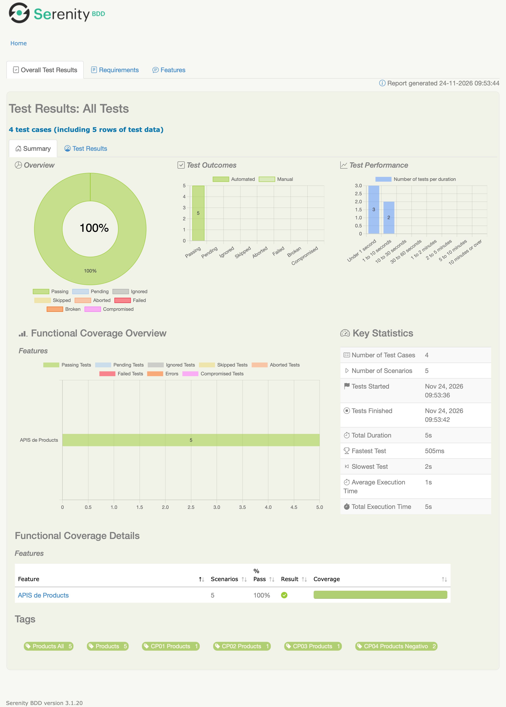
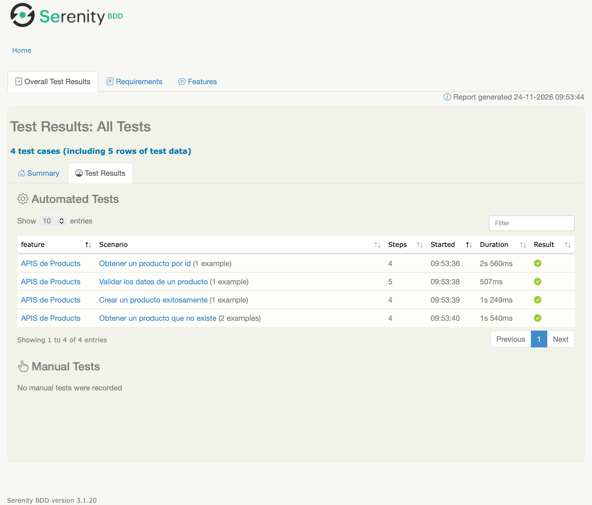
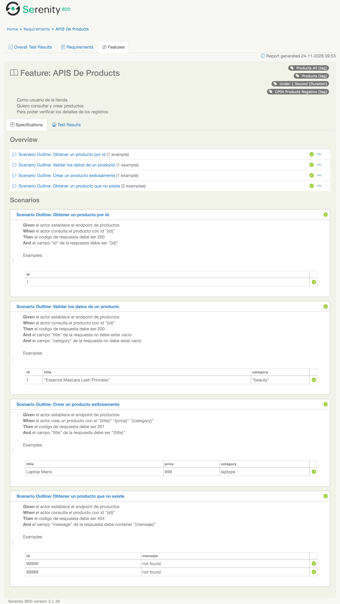

# Automatización de API de productos
Realizado por: Lucely Rubi Mendoza Deza

Práctica sobre pruebas de API 
 Se utilizó Java 17, Maven, Cucumber y Serenity Screenplay. 
Las pruebas se hacen contra [DummyJSON](https://dummyjson.com/docs/products), la cual se brindó y se basa en productos.

## Desarrollo

Se automatizaron dos endpoints y cuatro escenarios: tres positivos y uno negativo.

| Escenario | Endpoint | Tipo | Resultado esperado | Qué se valida |
|---|---|---|---|---|
| CP01 - Obtener un producto por id | GET `/products/{id}` | Positivo | 200 | El `id` de la respuesta es el que se pidió |
| CP02 - Validar los datos de un producto | GET `/products/{id}` | Positivo | 200 | `title` y `category` vienen con contenido |
| CP03 - Crear un producto | POST `/products/add` | Positivo | 201 | El `title` de la respuesta es el que se envió |
| CP04 - Obtener un producto que no existe | GET `/products/{id}` | Negativo | 404 | El `message` de la respuesta contiene "not found" |

En el escenario negativo el 404 es lo que se espera, así que cuenta como prueba aprobada.

Resultado de la última ejecución con `mvn clean verify`.

## Evidencias

**Resultados de Serenity (pestaña Test Results)**



**Resumen del reporte**



**Detalle de un escenario (request y response)**



## Estructura del ejercicio

```
src
├── main/java/org/example
│   ├── Tasks          GetProductById, PostProduct
│   └── Questions      ResponseCode, ResponseField
└── test
    ├── java/org/example
    │   ├── RunnerTest.java
    │   └── StepDefinitions   ParameterDefinition, Hooks, ProductStepDefinition
    └── resources/features    Products.feature
```

- **Feature (Gherkin):** Hice cuatro casos en español con `Scenario Outline` y su tabla `Examples`, para que los datos queden separados de los pasos.
- **Step definitions:** Aquí se conectan cada paso del feature con la Task o la Question que corresponde para products. 
- **Tasks (Screenplay):** `GetProductById` hace el GET a `/products/{id}` y `PostProduct` hace el POST a `/products/add` con el cuerpo en JSON.
- **Questions:** `ResponseCode` lee el código HTTP y `ResponseField` lee un campo del JSON de la respuesta. Con eso se validan tanto el código como los datos.
- **Serenity:** guarda cada escenario, paso, request y response en un reporte HTML.

El POST a `/products/add` de DummyJSON simula la creación pero no guarda nada en el servidor, por eso solo se valida lo que devuelve la misma respuesta.

## Cómo ejecutarlo

Desde la carpeta del proyecto:

```bash
mvn clean verify
```

El reporte queda en `target/site/serenity/index.html`.

### Si el reporte se ve en blanco

Pasa a veces en Chrome cuando se abre el archivo directo, porque no deja cargar los estilos y scripts locales, como en el caso que como no tuve espacio en la carpeta directamente de Intellij, lo realicé en la carpeta de descargas, presnetándome ese problema. Se soluciona abriéndolo desde un servidor local:

```bash
python3 -m http.server 8080 --directory target/site/serenity
```

Y entrando a `http://localhost:8080/index.html`.

